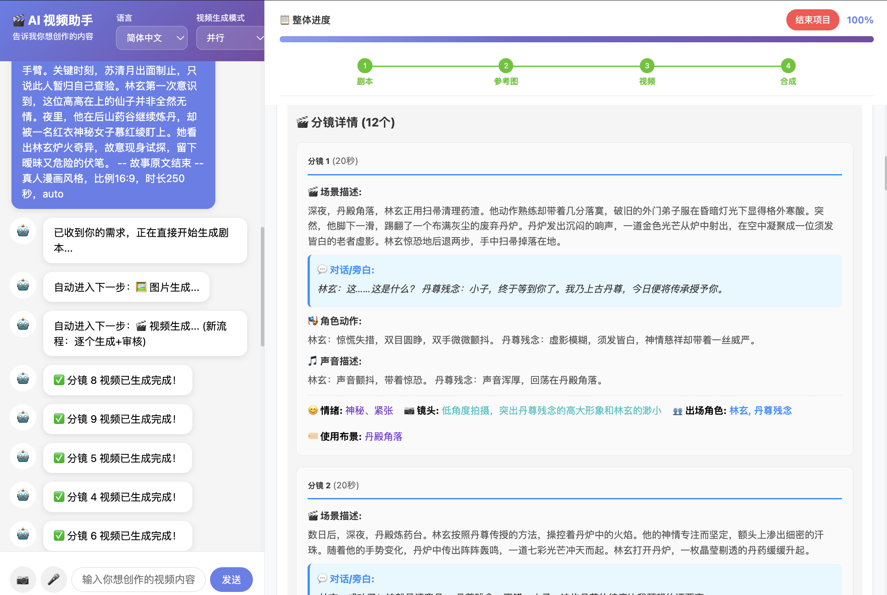
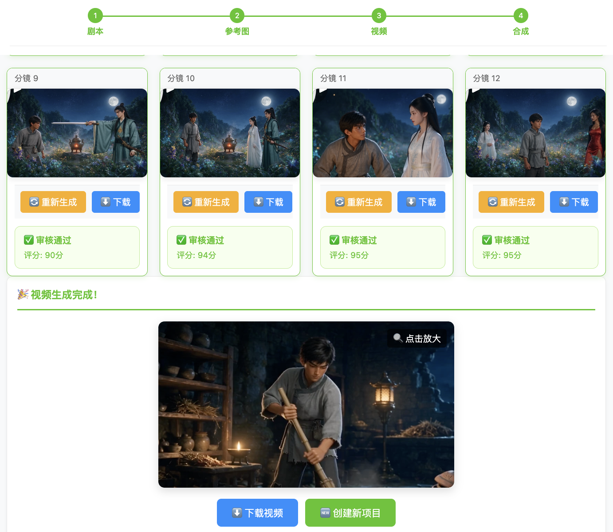
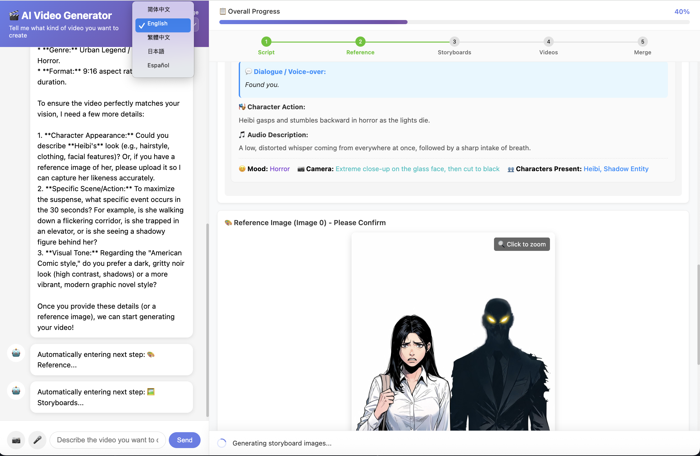

# Seedance Drama Maker · AI 短剧生成引擎

简体中文文档。English version: `README.en.md`

- 🌐 在线体验：<https://sd6npkalgt0sthatn3doa.apigateway-ap-southeast-1.apigw-byteplus.com/>
- 当前版本：`3.0.0`
- 技术栈：`FastAPI`、`WebSocket`、多 Agent 协作、`FFmpeg`
- 产品能力：`TOS`、`Seed-Speech`、`DeepSeek-V4.1-Flash`、`Seed-2.1-turbo`、`SeeDream-5.0-flash`、`SeeDance-2.5`
- AI 开发工具：`Trae.ai`、`DeepSeek-V4.1-Flash`、`GPT-5.5`

## ✨ Seedance 2.5 核心亮点

由 **SeeDance 2.5** 视频模型驱动，一句话即可产出电影级 AI 短剧：

- 🎬 **单镜头最长 30 秒**：单个分镜时长可达 30 秒（5–30 秒可调），长镜头叙事更连贯，最终成片总时长上限 `3600` 秒。
- 🖼️ **最多 50 个参考输入**：单任务可融合最多 50 张人物 / 布景参考图，角色与场景跨镜头高度一致。
- 🌍 **14 种语言原生支持**：原生多语种对白与旁白生成，覆盖中、英、日、西等 14 种语言。
- 🎞️ **电影级视听效果**：原生音画同步、自适应画幅比例，成片统一转封装为高保真 `MP4`（H.264/AAC，`+faststart`），Web 端可直接边下边播。
- 🎭 **角色装扮 / 布景状态变体**：按分镜自动派生角色装扮图与布景时间/天气状态图，并在分镜视频中一致引用。
- 🤖 **多 Agent 全自动流水线**：剧本 → 参考图库 → 角色装扮/布景状态变体 → 分镜视频生成与审核 → 长视频合成，一站式闭环。

## 项目简介

这是一个聚焦于 AI 长视频生成的多 Agent 系统，支持自动模式与手动模式两种工作方式。在保证生成质量的前提下，系统尽量简化人工操作，把用户从繁琐的脚本拆解、角色整理、布景统一、分镜衔接、质量复审和长视频合成中解放出来。

项目适用场景包括但不限于：

- 社交媒体数分钟广告视频生成
- 一句话生成短剧 / 漫剧
- 基于参考图片与语音输入生成连续叙事长视频
- 多个长视频任务并行运行，开箱即用

系统会自动协同生成剧本、角色设定、布景设定、对白、音效约束与分镜视频，并结合 AI 质量审核、自动/手动重生成、相邻分镜平滑过渡控制，完成从一句话需求到最终长视频成片的完整链路。

当前主流程为：

```text
需求输入 -> 剧本生成 -> 参考图库确认 -> 角色装扮/布景状态变体 -> 分镜视频生成与审核 -> 视频合成 -> 视频优化与字幕
```

独立的第五步“视频优化”支持本地与云端，结合真实成片视觉审核和 Whisper 音轨识别。默认 `video_optimization.fast_triage: true`，一次快速审核同时判断问题片段是否为关键剧情、局部质量分和是否无法接受：非关键问题直接剪除；关键剧情只有局部评分低于 `critical_regenerate_below`（默认 40）且明确无法接受时才自动补拍，其余保留并记录建议。剪切保护关键对白，冗余对白需整句剪除，保留总删除比例 20% 和最短剩余片段限制。Remotion 按剪后时间轴渲染实际音轨语言的字幕，同时输出 SRT、原片、优化片、审核报告及可编辑的 HyperFrames 时间线到 `VIDEO_OUTPUT_DIR/<project_id>/`（本地默认 `outputs`，云端为 `/tmp/seedance-outputs`）；视频、字幕和报告上传到私有 TOS。

快速模式关闭整片审核的额外推理、连续帧独立确认和重复因果审核，审核输出上限由 `fast_review_max_tokens` 控制（默认 1600）。同一母片复用审核；通过独立补片审核的局部替换，只复用未修改区域的判断，最终成片再快速复核一次。正常路径只有母片和成片两次审核，补拍仍检查指定修复点、原声与前后连续性。非关键片段剪除受完整对白或时长限制时记录保留原因，不转为自动补拍。底栏显示关键剧情与局部评分判断，日志记录审核模式、耗时及处理决定。关闭 `fast_triage` 可恢复详审流程；以下独立确认与因果审核说明仅适用于详审模式。

合成后可在 Web UI 指定多个剪除区间、多个局部补拍条目、光影校正、字幕和自动修复。删除片段支持换行或逗号分隔；每条补拍将开始秒、结束秒与独立修复要求配对，并支持添加与移除。自动补拍以审核确认的局部时间段为单位，例如 5–7 秒；多个补片并行生成与独立审核，再统一替换到同一版母片，保留原声轨并检查口型与前后衔接。分镜重排与整镜补拍不再显示于优化表单，后端仍兼容旧请求。底部状态栏固定一行，使用与其他步骤一致的 13px 字体并整体居中，显示项目名、当前审核、问题判断、修复方案、补片准备、重新生成、复核、替换、剪辑、字幕和整片复审的状态及耗时。并行项目横向滚动查看，悬停查看任务历史，支持刷新恢复。原始合成链接独立保留用于对比。

`video_optimization.fast_triage` 默认启用：一次审核同时判断问题是否涉及关键剧情、局部质量评分与观众是否无法接受。非关键问题优先剪除并同步调整字幕；关键剧情仅在评分低于 `critical_regenerate_below`（默认 40）且明确无法接受时自动补拍。可接受的瑕疵保留为建议，不重复深度确认。已审核母片与音轨转写可复用，合成后的成片再执行一次快速复审。

参考外部制作程序中的同场景色调统一、肢体与道具连续性检查、逐镜检查点补拍方法，加入幅度受限的同场景亮度校正，并保留剧本明确要求的开关灯等变化。剪辑与重组按实际媒体时长映射字幕，禁止切断完整对白。审核不可用时保留当前视频并记录原因；超过修复预算仍未通过的结果会明确标记，不能保证模型绝无穿帮。

明确要求中文或粤语对白时优先使用已配置的 Seed Speech ASR，保留真实用词和词级时间码；不可用时回退 Whisper（粤语使用 turbo）并记录不确定性，不用剧本台词替代真实识别，过滤空白时间段。相同音轨的转写缓存可用于仅改画面的新母片。Whisper 的 `zh` 标签不能单独证明普通话发音。合成前阈值由 `video_review.pass_threshold` 配置，默认 80；局部补拍使用独立的 `fragment_max_attempts` 预算（默认每段 2 次）、`fragment_max_seconds` 时长（默认 6 秒）、`max_repair_fragments_per_round` 数量（默认 8 段），并发由 `video_optimization.repair_workers` 配置。

字幕仅对与已匹配台词发音相同的中文错字进行校正，保留原词级时间码。无对白镜头若把制作说明朗读为旁白，需由原生 ASR 与独立 Whisper 复核一致后，局部替换为邻近无对白环境音，保留画面和时长；由 `remove_prompt_narration` 配置控制。整体优化采用适度审核尺度，保留题材允许的法术与特效，不因微小构图变化或重复铺垫缺失补拍。

独立问题确认只接收需检查的时间区间，不接收首轮的指控文字，避免重复误判。`video_optimization.repair_min_severity` 默认 `major`：轻微装饰差异保留在报告建议中；明确的肢体畸变、接触错误、身份跳变和关键因果缺失仍需修复。并行补片按内容哈希独立上传，防止同一秒上传时覆盖另一补片，确保复核读取对应片段。

`audit_story_impact` 默认启用：独立确认后，再根据完整影片与连续帧检查问题是否造成实际身份、接触或因果错误，保留观测记录。合理觉醒特效或镜头变化不因“角色设定未列出”而判错；纹样互相匹配且识别成立、觉醒与战斗因果完整时，不因纹样名称或特效形式不同阻断成片。减少爽感、仪式感或文字还原度只能作为建议，实际肢体、接触、身份及因果矛盾仍需修复。低置信度、审核不可用或格式错误均不能放行原有阻断问题。道具修复参考图优先展示清楚可见的修正细节，避免用人物肖像或反应镜头替代修复。

成片复审发现的问题也使用实际成片的连续时间码帧独立确认，失败补拍记录不作为画面证据传给复审模型。手动退回优化后重新计算本轮片段预算，保留历史报告；补拍参考中的错误道具或肢体不应覆盖文字修复要求。

`repair_reference_after_failure` 默认启用：文字补拍失败后，ImageAgent 先根据实际边界帧与匹配角色参考生成修正目标图，并独立验证修复部位是否清楚可见、接触正确、没有重复道具；不合格时根据实际反馈重绘，次数由 `repair_reference_max_attempts` 控制（默认 2 次）。验证通过后才用于补拍；目标图不作为视频审核通过的证据。生成和验证过程均显示在一行底栏中。手动再次执行优化开启新的局部补拍预算，并保留已通过补片的工作母片；同一次执行的自动复审轮次共享预算。

每段补拍先把错误观测转为正向修复目标、必要局部动作和可见验收项，分别保留原始错误与修复目标，防止把“完整剑而非断剑”等错误描述当作生成要求。验证通过的修正目标图使用 `first_frame` 锁定补片首帧，视频比例沿用该图片，不与普通人物/错误边界参考混合；生成的实际短片仍需独立审核。

模型的最短输出可能长于待修区间。无对白补片可由 `select_silent_patch_window` 启用有效动作窗口选择，跳过模型额外铺垫，再按原母片区间替换；原声和母片时间轴不变，选出的短片仍须通过独立修复复核。有对白的补片保留提示词规定的起始词级时间轴。局部补拍清除整镜角色动作和声音指令，并使用聚焦问题部位的机位；生成素材链接、时长和边界参考保留在历史中。

审核使用统一的身份、肢体、接触、道具、剧情、光影、对白类别，并兼容模型返回的中英文类别名称；独立复核可以把首轮区间收窄到实际问题发生的位置。每项问题定位单次出现的短区间，补片只修复该区间，不重演整段背景动作。Remotion 字幕渲染后重新挂接剪后原声并约束实际时长，避免 AAC 编码填充延长成片。

时间段与大类重叠不能单独证明独立确认。对可明确识别的额外手指、缺失手指、重复肢体、融合和穿透等不同缺陷，复核必须与首轮指控一致；同一区间中新发现的另一种缺陷留待单独确认，避免误把新问题当作旧问题已证实。

合成前审核与优化审核分别通过 `video_review.sample_fps` 和 `video_optimization.review_fps` 配置抽帧密度，默认每秒 3 帧，范围 0.2–5；短补片也需要多个动作观测，减少因稀疏抽帧漏看接触动作或短特效的误判。提高密度会增加审核耗时与模型用量；修改密度后不会复用旧审核缓存。

`models.video_review.disable_thinking` 默认启用，使视觉审核直接输出画面证据与结论，降低额外推理耗时；设为 `false` 可启用模型推理，单次调用显式设置 `thinking` 时优先使用该设置。此项仅作用于审核模型，审核阈值和独立确认要求不变；切换模型或此设置后会重新审核，避免复用旧模式的缓存。

手指修复目标先单独审核目标图，依据指尖轮廓、掌部连接与关节识别一根拇指及四根手指；通过后再对照边界图检查服装、身份与光影连续性，避免原错误手部污染数指结论。单帧不需要证明画外人物、道具、动作或音轨。`anatomy_review_thinking` 默认开启推理，`anatomy_review_max_tokens` 默认 3000，也用于局部手指补片、整片区间复核和手指问题的影响审核；修改后旧审核缓存失效。目标验证异常或失败不会继续生成补片。

用户指定的局部补拍未通过且未替换时，整片审核即使未再次发现问题，也不会把本次优化标为完成；未完成区间保存在 `unresolved_manual_repairs` 中。

独立确认会额外读取同一版母片的连续画面，每个疑点含前后 0.3 秒上下文、最多 24 帧并标注母片时间码；这些画面与角色参考图分开传入，减少把已经出现的短动作判为缺失。纹路被遮挡不能作为纹路错误的证据，动作存在与装饰差异需要分开判断。

局部补片除总分达到阈值外，还必须返回指定修复点已验证的结论和时间码证据；仅人物、风格或前置反应匹配不能通过。底栏的补片任务会随准备、生成、审核切换名称和阶段计时。退回“视频优化”从原始合成片重新开始，保留历史审核记录用于追溯。

Skills 默认使用仓库的 `app/video_skills`，包含七个 skills 实际使用的参考文件和哈希清单，可通过 `VIDEO_SKILLS_ROOT` 覆盖。Node 运行库由 `runtime/package-lock.json` 固定版本，云端位于 `/opt/video-tools`，本地默认位于 `~/.local/share/seedance-drama-maker/video-tools`。`znyupup/ai-video-editing-skill` 的技能名为 `vlog-auto-edit`。Python 依赖使用 `uv pip install --python .venv/bin/python -r requirements-video-tools.txt`。Remotion captions 实现字幕；完整优化运行时包含在 v3.0 云端镜像内。

系统重点解决以下问题：

- 剧本、角色设定、布景设定、分镜脚本的统一生成
- 多参考图协同生成，支持人物/角色与布景分流
- 自动模式与手动模式下的一致流程控制
- 视频审核失败后的自动重试与人工接管
- 多语言前端与多浏览器标签页独立任务隔离
- 云端交互式请求隔离：上传与录音转文字走独立线程池，避免被生图/生视频长阻塞任务挤占导致网关超时

## 项目展示

### 界面与生成流程

**UI 界面展示与生成剧本**：一句话需求输入后，系统自动生成标题、风格、角色设定、布景设定与分镜脚本。



**分镜视频与合成**：逐个分镜生成视频、AI 审核并进行最终长视频合成。



**支持多语言**：前端界面支持 `zh-CN` / `zh-TW` / `en` / `ja` / `es`，视频对白原生支持 14 种语言。



### 视频演示

- 全自动 Agent 演示：[demo/how-to-use-cn.mp4](./demo/how-to-use-cn.mp4)
- 2 分钟真人剧：[demo/real-drama.mp4](./demo/real-drama.mp4)
- 2 分钟漫剧：[demo/comics-drama.mp4](./demo/comics-drama.mp4)

## 使用的 BytePlus 产品

- `TOS`
  用于上传、存储和分发用户上传素材、参考图、分镜视频和最终视频。
- `Seed-Speech`
  用于语音转文字，支持通过录音输入视频创作需求。
- `DeepSeek-V4.1-Flash`
  用于主对话 Agent 与剧本分镜生成。
- `Seed-2.1-turbo`
  用于分镜视频审核，评估人物/角色一致性、物理规律和脚本语义一致性。
- `SeeDream-5.0-flash`
  用于人物/角色参考图与布景参考图生成和重生成。
- `SeeDance-2.5`
  用于分镜视频生成，支持单镜头 5–30 秒、最多 50 个参考输入、14 种语言原生对白与原生音画同步。

以上能力来自 [byteplus.com](https://www.byteplus.com/)。

## AI 开发工具

- `Trae.ai`：代码开发、排查、工程整理
- `DeepSeek-V4.1-Flash`：需求梳理、方案讨论、文档辅助
- `GPT-5.5`：代码修改、逻辑整理、调试、文档重写

## 运行前提准备

### 环境要求

- Python `3.11`、Node `22+`、Chromium；Whisper 使用 CPU PyTorch
- 运行环境可执行 `ffmpeg` 与 `ffprobe`（本地、Docker、云端 veFaaS 镜像均需要安装）
- 网络可访问 BytePlus / ModelArk / Seed-Speech / TOS

### 服务开通要求

在运行本程序前，需要先准备以下账号和能力：

- 开通 `ModelArk` 对应模型，并获取 `apikey`
- 开通 `Seed-Speech`，并获取 `appid` 与 `apikey`
- 开通 `TOS`，并获取 `AK/SK`
- 在 `TOS` 中建立你自己的私有存储桶 `bucket`
- 在 `config.yaml` 中配置这些服务的 `endpoint` 等非敏感项；真实的 `apikey` / `AK` / `SK` / `appid` / `bucket` 一律写入项目根目录的 `.env`

### 凭证治理规则

- 所有模型 `apikey`、对象存储 `AK/SK`、语音识别凭证、`endpoint` / `bucket` 等敏感信息，只允许在 `.env` 中设定。
- `config.yaml` 仅保留 `${VAR}` 占位符，运行时由 `app/config.py` 从 `.env` 注入，业务代码不得硬编码任何真实凭证。
- `.env` 已被 `.gitignore` 忽略，禁止提交到版本库；可复制 `.env.example` 作为模板填写真实值。
- 如果不同模型使用不同 `apikey`，也只能放在 `.env` 的对应变量中。

### 最小配置示例

敏感凭证写入项目根目录的 `.env`（可复制 `.env.example`）：

```bash
# BytePlus TOS 认证
BYTEPLUS_AK=your-byteplus-ak
BYTEPLUS_SK=your-byteplus-sk
TOS_REGION=ap-southeast-1
TOS_BUCKET=your-private-bucket
TOS_ENDPOINT=https://tos-ap-southeast-1.bytepluses.com
TOS_PRIVATE_BUCKET=true
TOS_PRESIGNED_URL_EXPIRES=604800
TOS_PRESIGNED_URL_REFRESH_MARGIN=3600

# ModelArk
MODELARK_API_KEY=your-modelark-api-key
MODELARK_BASE_URL=https://ark.ap-southeast.bytepluses.com/api/v3

# Seed-Speech ASR
SPEECH_APPID=your-seed-speech-appid
SPEECH_API_KEY=your-seed-speech-api-key

# 大模型 Endpoint / API Key
MAIN_AGENT_ENDPOINT=your-main-agent-endpoint
MAIN_AGENT_API_KEY=your-main-agent-api-key
SCRIPT_ENDPOINT=your-script-endpoint
SCRIPT_API_KEY=your-script-api-key
IMAGE_ENDPOINT=your-image-endpoint
IMAGE_API_KEY=your-image-api-key
VIDEO_ENDPOINT=your-video-endpoint
VIDEO_API_KEY=your-video-api-key
VIDEO_REVIEW_ENDPOINT=your-video-review-endpoint
VIDEO_REVIEW_API_KEY=your-video-review-api-key

# Virtual asset library
ASSET_LIBRARY_REGION=ap-southeast-1
ASSET_LIBRARY_API_HOST=ark.ap-southeast-1.byteplusapi.com
ASSET_LIBRARY_PROJECT_NAME=default

# 仅允许明确年满18岁的角色生成半裸/裸体内容
NSFW_ENABLED=off
```

`config.yaml` 中对应字段保留占位符即可，运行时会自动从 `.env` 注入：

`NSFW_ENABLED=on` 时，剧本、角色主图、角色装扮图和分镜视频会统一启用成年角色裸露策略；关闭时这些生成链路会明确要求非露骨穿衣内容。该策略由代码和公共提示词统一实现，不再依赖额外私有提示词目录。

```yaml
byteplus:
  ak: "${BYTEPLUS_AK}"
  sk: "${BYTEPLUS_SK}"

modelark:
  api_key: "${MODELARK_API_KEY}"
  base_url: "${MODELARK_BASE_URL:-https://ark.ap-southeast.bytepluses.com/api/v3}"

server:
  port: 8888

models:
  main_agent:
    endpoint: "${MAIN_AGENT_ENDPOINT}"
    api_key: "${MAIN_AGENT_API_KEY}"
  # 其余模型段同理，均使用 ${VAR} 占位符
```

## 功能与流程介绍

### 1. 需求输入

支持以下输入方式：

- 文字描述
- 上传参考图片
- 录音输入并调用 `Seed-Speech` 转文字

录音转文字链路会保留浏览器实际录音格式：Chrome / 云端浏览器常见的 `webm/opus` 会以 `.webm` 上传，并在提交 `Seed-Speech` 时自动使用 `format=webm`、`codec=opus`；本地或其它环境生成的 `wav/mp3/m4a/ogg` 也会按扩展名自动适配。ASR 轮询属于阻塞式网络调用，服务端统一放入交互式线程池执行，避免与生图/生视频生成线程池互相阻塞。

### 2. 剧本生成

`ScriptAgent` 负责生成：

- 标题、风格、背景
- 角色设定
- 布景设定
- 分镜脚本

当前逻辑约束：

- 视频总时长上限：`3600` 秒
- 单个分镜时长范围：`5`–`30` 秒（适配 `SeeDance-2.5`）
- 分镜时长按动作节点、出场人数、信息量、空间调度和情绪转折动态分配；简单镜头使用短时长，复杂剧情使用长时长，并在总时长允许时形成至少 `2` 秒跨度和多档时长
- `description` 按连续秒段提供可执行细节：`5`–`9` 秒至少 2 段、`10`–`18` 秒至少 3 段、`19`–`30` 秒至少 4 段，并覆盖环境空间、人物动作与细微表演、镜头、光影和剧情结果
- 分镜数量上限：`200`
- 角色设定上限：`30`
- 布景设定上限：`30`
- 相邻分镜通过动作/视线/道具/构图匹配、声桥、自然遮挡或光影呼应连贯承接；连续场景优先直接延续表演，避免模板化转场特效和每镜强行悬念
- 叙事钩子必须来自已建立的人物选择、事件后果、部分揭示的信息、声音、道具或情绪变化，并由后续分镜兑现；视频生成阶段禁止擅加无剧情动机的黑屏、闪白、旋转、粒子、故障、连续甩镜或频繁淡入淡出
- 剧本质量校验未通过时，脚本模型会基于上一轮完整 JSON 和具体校验结果定向修正，仅调整问题部分，不从原始需求重新生成
- 生成、改稿与定向修正使用统一校验：检查锁定设定、结构、时长与叙事连贯性；语义审稿发现的问题需经事实复核确认，避免因继承的机位、光源或道具插镜产生误判
- `script_generation.validation_max_rounds` 默认 `3`，包含首次生成与后续修正；已有效的导演时长计划优先保留，必要时再微调
- 轮次耗尽后，手动模式暂停后续生成，可选择重新启动整个项目或使用最佳候选剧本继续；刷新页面可恢复待选状态。自动模式直接选择最符合要求的候选继续，按锁定设定、结构可执行性、时长与已确认问题数量排序
- 分镜中的特殊装扮与发型变化显式写入 `character_outfits`，布景时间/天气状态显式写入 `scene_state`；两者均位于“场景描述”之前，并持久化用于后续生图/生视频
- 服务端 `INFO` 日志仅记录模型、消息数量、Prompt/请求体长度等摘要；完整 Prompt、请求体、素材轮询结果和心跳仅在 `DEBUG` 级别输出，避免长任务产生超大日志

### 3. 参考图库生成

`ImageAgent` 会生成统一参考图库，分为：

- 人物/角色参考图库
- 布景参考图库

当前支持的上传规则：

- 前端一次最多上传 `30` 张参考图
- 其中人物/角色最多 `10` 张
- 布景最多 `20` 张
- 每张上传图片都需要命名

上传后的两种行为：

- 勾选“使用原图”
  不再对上传图和命名做大模型处理，直接按类型进入参考图库。
- 不勾选“使用原图”
  系统会基于上传图和剧本中的角色/布景设定生成统一参考图库。

只有在所有参考图生成或重生成任务都完成后，系统才会进入下一步倒计时或等待继续指令。

### 3.1 虚拟素材库（Private Virtual Portrait Library）

系统已经接入虚拟素材库能力：

- 每个项目创建独立素材资产组，维持项目与素材资产组一一对应
- 项目内所有人物/角色图片，包括上传原图与生成参考图，都会注册为素材资产并记录 `asset_id`
- 支持 NSFW 素材上传，创建素材时使用 `Moderation.Strategy = Skip` 关闭 Content pre-filter
- 只有当素材状态轮询到 `GetAsset.Status = Active` 后，才会进入视频生成链路

鉴权说明：

- 视频推理仍使用 `ModelArk Bearer API Key`
- 素材库接口使用 `BytePlus AK/SK` 签名调用
- 因此运行时必须同时配置 `MODELARK_API_KEY` 与 `BYTEPLUS_AK/BYTEPLUS_SK`
- 当前账号还需要在 BytePlus 控制台开通虚拟素材库对应订阅，否则 `CreateAssetGroup` 会返回 `SubscriptionRequired`

### 3.2 角色装扮图与布景状态图

在所有角色主图与场景主图生成完成后，系统会按各分镜内容自动派生变体图：

- 仅当分镜 `character_outfits` 包含与默认 `clothing` / `hairstyle` 不同的角色装扮，或 `scene_state` / `time_of_day` / `weather` 与布景默认状态不同时才生成
- 角色装扮图 = 该分镜的角色装扮描述 + 对应角色主图
- 布景状态图 = 该分镜的时间/天气状态 + 对应场景主图
- 多个分镜的装扮图/状态图并行生成，受图片生成并发数（`video_generation.reference_images.max_concurrency`）控制
- 角色装扮按服饰、裸露层级、发型和伤痕等稳定视觉特征去重；布景状态按时间与天气归一化去重，细微措辞变化不会重复生成
- 每张变体图通过 `scene_numbers` 与一个或多个分镜强绑定，分镜视频优先使用当前编号命中的变体
- 分镜视频选择装扮图时直接按 `scene_numbers`、精确 `variant_key`、视觉等价描述依次匹配，不会为每个角色重复扫描和重建整份分镜变体计划

### 3.3 分镜视频生成

`VideoAgent` 生成每个分镜视频时，会结合：

- 角色图（若该分镜有角色装扮图，则优先使用角色装扮图）
- 场景图（若该分镜有布景状态图，则优先使用布景状态图）
- 当前分镜脚本与用户风格要求

其中人物/角色参考图会优先使用虚拟素材库的 `asset://asset-id` 形式写入视频生成请求，例如：

```json
{
  "type": "image_url",
  "role": "reference_image",
  "image_url": {
    "url": "asset://asset-xxxxxxxx"
  }
}
```

分镜视频仅引用与当前分镜匹配的角色图和场景图。自动审核时按配置的并发数并行生成；手动审核时逐个生成并等待用户确认。

关键规则：

- 自动失败重试次数受 YAML 配置限制（`video_review.max_retries`、`video_generation.scene_total_generate_limit`）
- 人工点击“重新生成”不计入自动失败预算
- 视频提示词默认追加“限定：不生成背景音乐”，除非用户需求中明确指定背景音乐风格
- 当 `NSFW_ENABLED=on` 且角色明确年满 18 岁时，若当前分镜语义表明亲密行为仍在继续，会继承上一分镜的半裸/裸体装扮状态；剧情明确结束后才恢复使用当前分镜指定的其他角色图
- 分镜编号始终按剧本数组顺序规范为 `1..N`；生成结果同时保存分镜内容指纹，防止编号正确但内容错绑
- 分镜视频归档名使用可排序格式 `scene_012_attempt_03.mov`

### 3.4 项目结束与资源清理

Web UI 新增“结束项目”按钮，并支持在以下场景触发清理：

- 用户手动点击“结束项目”
- 用户主动关闭当前项目页面
- 用户关闭浏览器，前端通过 `sendBeacon` / `keepalive fetch` 做最佳努力上报

清理范围：

- 删除本项目在 `TOS` 中的临时文件与临时目录
- 删除本项目虚拟素材库中的素材资产
- 删除本项目对应的素材资产组

如果项目已经产出最终视频，则保留 `videos/final` 下的最终成片，避免误删导出结果。

### 4. 视频审核与流程推进

`VideoReviewAgent` 使用 `Seed-2.1-turbo` 做分镜视频审核。

审核维度：

- 人物/角色一致性
- 物理世界规律
- 与分镜脚本语义一致

人物一致性审核会为当前分镜的每个出场角色选择参考图：优先使用该分镜绑定的角色装扮图，无匹配装扮图时才回退角色主图。

当前默认审核配置：

- `video_review.pass_threshold = 80`
- `video_review.max_retries = 2`
- `video_review.default_mode = auto`

流程规则：

- 自动模式：审核失败后自动重试；达到上限后自动选择最高分结果继续流程
- 手动模式：审核仍会执行，但不自动重试；用户可以手动继续下一步
- 审核服务网络或传输异常不等同于视频质量不合格：系统保留当前视频且不会因此重新生成；HTTP `400` 参数错误不做无效重试
- 只要仍有自动或人工“重新生成”任务未完成，系统不会提前进入下一步 countdown
- 云端长任务通过稳定 `client_id` 路由到最新 WebSocket 连接；即使 API 网关或浏览器中途重连，后台生成完成和审核结果仍会推送到当前前端
- 自动模式下每个分镜完成后都会即时持久化项目状态；失败分镜会在并行任务全部收敛后倒序移除并统一重编号，避免竞态导致视频与剧本错位
- 自动模式达到重试上限后选择最高分视频继续时，会标记为“已接受（超过重试次数）”，不会阻塞后续合成
- 项目结束后，排队中的并行分镜会静默停止；进行中的远端生成返回后会在归档、审核和重试边界再次检查结束状态，不再继续无效处理

### 5. 合成

`MergeAgent` 与 `FFmpegService` 负责最终合成。

当前默认合成配置：

- `SeeDance-2.5` 生成任务与参考视频统一使用 `MOV`，`FFmpeg` 多段合成为 `MOV`
- 合成前对各分镜片段做参数归一化（统一 H.264/`yuv420p` + AAC `48kHz` 立体声 + CFR），避免不同片段音频采样率/编码不一致导致成片后半段无声或 Web 播放中断
- 合成后统一转封装为 `MP4`（优先 `-c copy` 无损转封装，失败回退 `H.264/AAC` 重编码），并启用 `-movflags +faststart` 前置 `moov atom`，Web 端可边下边播
- 最终上传并由前端播放的成片为 `MP4`
- 合成前严格校验分镜编号是否重复、缺失或多余，并核对每段视频的分镜内容指纹；最终始终按剧本数组的物理顺序合成
- `merge.temporary_edge_trim = on`
- `trim_previous_end_frames = 2`
- `trim_next_start_frames = 0`

视频与审核全部完成后：

- 自动模式：先显示倒计时，再自动进入合成
- 手动模式：先显示倒计时提示，随后等待聊天区继续指令进入合成

## 提示词示例

### 自动模式

`以女生heibi为主角，香港中环写字楼场景，生成美漫风格，都市怪谈悬疑恐怖故事。比例9:16，时长30秒。auto`

### 手动模式

`以大学校园为场景，Q版动漫风格，学生的励志故事。比例4:3，时长90秒`

### 支持上传素材

- 可上传 `参考图片`
- 可上传 `语音`
- 可混合上传人物/角色图和布景图

## 系统架构

```text
Browser UI
  |- static/index.html
  |- static/css/style.css
  |- static/js/app.js
  |- static/i18n/*.json

FastAPI App
  |- app/main.py
  |- REST API
  |- WebSocket manager

MainAgent
  |- ScriptAgent
  |- ImageAgent
  |- VideoAgent
  |- VideoReviewAgent
  |- MergeAgent

Services
  |- LLMService
  |- ASRService
  |- TOSService
  |- FFmpegService
```

### 关键设计点

- 所有敏感凭证统一写入 `.env`，`config.yaml` 仅保留 `${VAR}` 占位符，运行时由 `app/config.py` 注入
- TOS 对象保持私有 ACL；浏览器、模型、审核与 ASR 使用自动续签的临时 GET URL，后端复制、合成和状态快照直接通过 TOS SDK 读写
- 前后端界面支持 `zh-CN`、`zh-TW`、`en`、`ja`、`es`；`SeeDance-2.5` 视频对白原生支持 14 种语言
- 视频链路生成阶段统一使用 `MOV`，最终成片统一转封装为 `MP4`（`+faststart`），`TOS` 归一化 `Content-Type` 保证 Web 端正常播放
- 项目与浏览器连接绑定，支持多标签页独立运行
- 后台长任务通过稳定客户端 ID 支持 WebSocket 断线重连后的结果续推
- 参考图库、视频生成、审核、合成都采用渐进式前端展示
- 最终视频会在项目结束清理中保留
- 上传、ASR 等实时交互请求使用独立 `interactive` 线程池；生图、生视频、审核、合成等长任务使用 `generation` 线程池，降低云端单实例多项目并发时的排队超时风险

## 使用说明

### 安装依赖

```bash
uv venv --python 3.11
uv pip install --python .venv/bin/python -r requirements.txt -r requirements-video-tools.txt
npm ci --prefix runtime
mkdir -p ~/.local/share/seedance-drama-maker/video-tools
cp -R runtime/node_modules ~/.local/share/seedance-drama-maker/video-tools/
```

系统安装 FFmpeg/FFprobe 和 Chromium。首次使用 Whisper 会下载模型；云端镜像预置 `small` 和 `turbo`。本地 Mac 可使用 Remotion 自动下载的浏览器；Linux 建议设置 `REMOTION_BROWSER_EXECUTABLE=/usr/bin/chromium`。

### 启动服务

```bash
python3 -m app.main
```

默认访问地址：

```text
http://localhost:8888
```

### 常用指令

- `开始生成` / `开始` / `生成`
- `继续` / `下一步` / `确认`
- `重新生成` / `重做` / `regen`
- `退回-剧本` / `退回-参考图` / `退回-视频`
- `一键生成` / `autorun` / `auto`

## 最新联调验证

项目最近一次本地真实联调已完整跑通以下链路：

- 上传人像到 `TOS`
- 上传语音并调用 `Seed-Speech` 完成 `ASR`
- 验证浏览器录音 `webm/opus` 与本地 `wav` 均可正确提交到 `Seed-Speech`
- 创建项目级虚拟素材资产组并注册人物资产
- 使用真实剧本模型生成剧本
- 在视频生成请求中使用 `asset://asset-id` 注入人物参考
- 完成多分镜视频生成、AI 审核与最终合成
- 触发“结束项目”后自动清理 `TOS` 临时文件、素材资产和素材资产组

说明：

- 最近一次真实 E2E 已成功产出最终视频并上传至 `videos/final`
- 分镜审核、最终合成、项目结束清理均已在真实调用链路中验证
- 清理逻辑默认删除临时素材与中间产物，保留最终成片，避免误删导出结果

## 仓库清理与安全提交

为避免公开仓库泄露密钥或测试产物，当前仓库遵循以下规则：

- 所有真实 `apikey`、`AK/SK`、`appid`、私有桶名只允许保留在本地 `.env`
- `.env`、`/.run/`、`*.log`、缓存目录、`/plan.md`、`/docs/` 均不进入 Git
- README、`config.yaml`、`.env.example` 只保留占位符示例，不写入真实凭证
- 提交前请确认测试音频、测试图片、服务日志、临时导出文件没有进入暂存区
- 临时分享包、压缩导出、密钥文件和本地部署 JSON 均排除在 Git 与镜像上下文之外；发布前检查暂存区和历史记录，扫描只报告文件路径，不输出密钥值

### 云端发布

发布顺序为 `git commit → git push → 重建镜像 → 发布 veFaaS`。`Dockerfile` 基于 Python 3.11 与 Node 22，包含 FFmpeg/FFprobe、Chromium、Noto 字体、CPU PyTorch、Whisper `small` / `turbo` 缓存及固定版本 HyperFrames、Remotion 和 captions。所有提示词和有限 skills 参考文件均随镜像发布。启动命令为 `./run.sh`，监听 `_FAAS_RUNTIME_PORT`（默认 8000），单进程 Uvicorn；后台任务状态通过私有 TOS 持久化。

BytePlus `ap-southeast-1` 的 veFaaS 使用常驻最少 `1`、最多 `5` 个实例。新版本就绪后切换全部流量，保留上一版本用于回滚，并验证云端页面、多语言文件、私有 TOS 签名访问与发布状态。

安装官方 [BytePlus CLI](https://github.com/byteplus-sdk/byteplus-cli)，使用 `bp configure --profile seedance-v3` 私下填写 AK/SK 和 region。`.env` 中填写模型、TOS、ASR 配置，以及 `CLOUD_ACCESS_PASSWORD`；部署脚本将其映射为云端 `ACCESS_PASSWORD`，自动生成共享 `ACCESS_SECRET` 并设置 HTTPS Secure Cookie。本地 `ACCESS_PASSWORD` 留空。真实凭证只注入函数环境变量，不进入 Git、构建参数或镜像层。

```bash
.venv/bin/python scripts/audit_secrets.py
.venv/bin/python scripts/deploy_byteplus.py \
  --profile seedance-v3 --region ap-southeast-1 \
  --gateway-id YOUR_GATEWAY_ID --registry YOUR_CR_REGISTRY \
  --namespace YOUR_CR_NAMESPACE --builder dmbuilder
```

脚本从 `git archive HEAD` 构建 `linux/amd64` 镜像，创建独立 v3 函数与 API 网关服务、VeFaaS upstream 和 `/` 前缀路由，配置 4 vCPU / 8 GiB、900 秒请求超时和 1–5 实例。路由 API 使用版本 `2022-11-12`，支持 WebSocket。部署状态保存在被忽略的 `.run/deployment-v3.json`，可重复执行恢复。

云端环境变量清单：`BYTEPLUS_AK/SK`、`TOS_*`、`MODELARK_*`、五类模型 `*_ENDPOINT` / `*_API_KEY`、`SPEECH_*`、`ASR_RESOURCE_ID`、`ASSET_LIBRARY_*`、`NSFW_ENABLED`，以及 `ACCESS_PASSWORD` / `ACCESS_SECRET` / `ACCESS_COOKIE_SECURE`。运行时设置 `VIDEO_SKILLS_ROOT=/app/app/video_skills`、`VIDEO_TOOLS_RUNTIME_DIR=/opt/video-tools`、`WHISPER_CACHE_DIR=/opt/whisper-models`、`VIDEO_OUTPUT_DIR=/tmp/seedance-outputs`、`REMOTION_BROWSER_EXECUTABLE=/usr/bin/chromium`；脚本仅复制配置引用的变量。

`/healthz` 只返回健康状态与版本；登录后的 `/api/runtime` 返回不含密钥的依赖和 skills 就绪状态。镜像内可用 `python -m app.services.runtime_service --smoke` 验证实际剪辑、字幕渲染、时间线 lint、两种 Whisper 模型及音轨/时长。WebSocket 推送为实例内路由，跨实例通过快照轮询补齐；实例回收后的在途任务重启和跨实例写入仲裁仍需要任务队列与共享锁，TOS 快照本身不是分布式任务队列。

## Prompt 与 Skill 统一管理

- 可复用的 LLM prompt、图像/视频生成约束、审核规则与脚本生成规则统一存放在 `app/prompt_skill/*.md`
- 代码通过 `app.prompt_skill.load_prompt()` 或 `app.prompt_skill.render_prompt()` 读取 Markdown 模板；新增稳定 prompt 时优先新增 `.md` 文件，不再把大段规则硬编码在 Agent 中
- Markdown 模板使用 `$变量名` 注入动态值，避免与 JSON 示例中的 `{}` 冲突
- 仍需根据运行时条件决定是否追加的动态上下文（用户输入、语音识别结果、参考图 URL、分镜字段、角色/布景名等）保留在代码中拼接

## 开源使用规则

- Copyright (c) 2026 Alex Wang
- @author Alex Wang <https://github.com/wanglongxiao>
- @contact <https://www.linkedin.com/in/alexwanglx/>
- 转载、分发和二次修改时，请保留项目内的作者与开源说明注释。
- 请勿提交真实 `apikey`、`AK/SK`、私有桶名、私有素材或生成结果到公开仓库。

## 版本与变更记录

- 当前版本说明见 `CHANGELOG.md`
- 英文版本见 `CHANGELOG.en.md`
